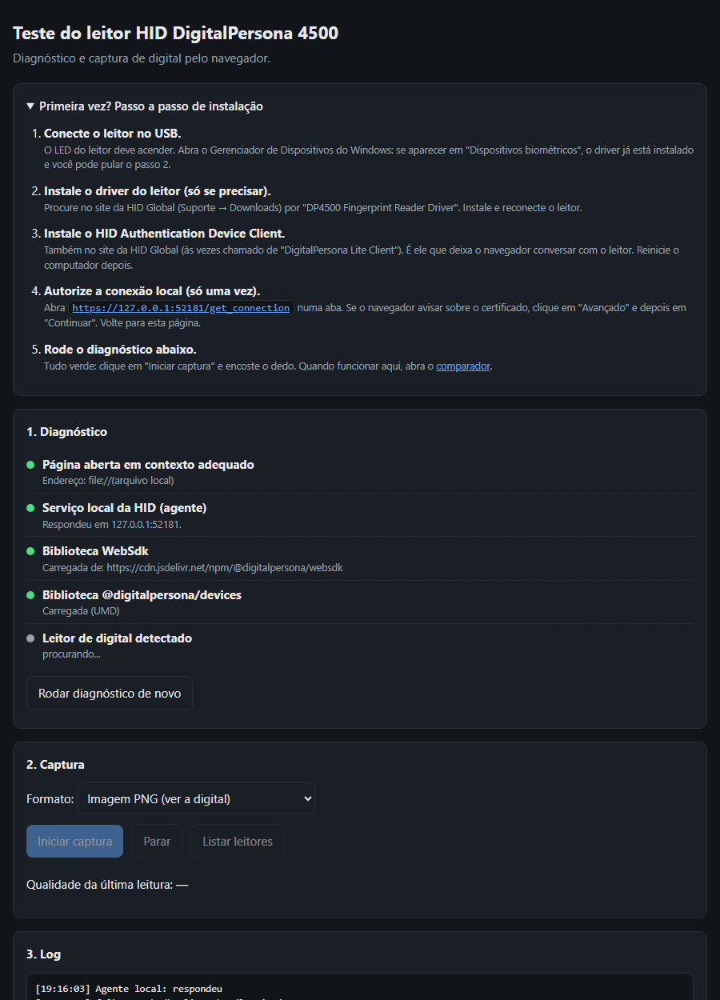
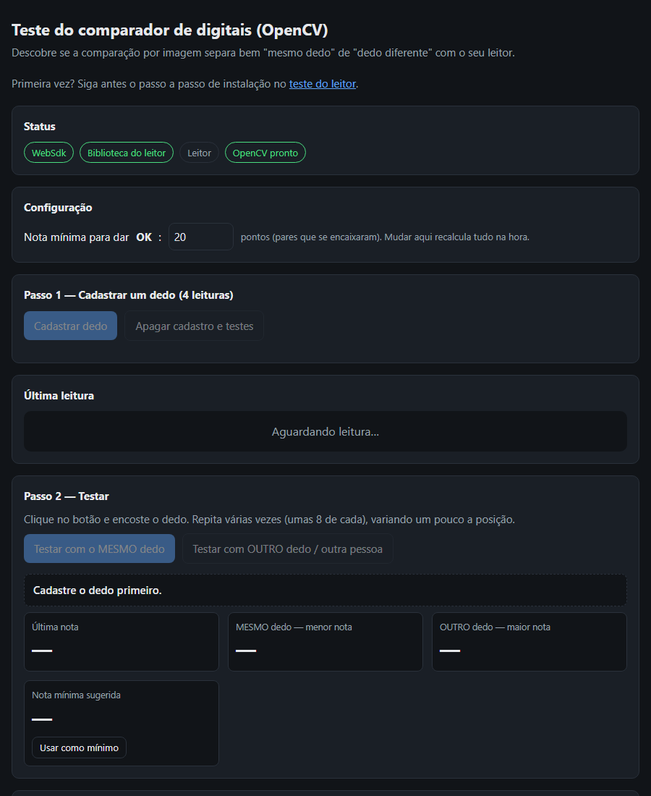

# Leitor de digital HID DigitalPersona 4500 no navegador

Duas páginas HTML, sem servidor e sem SDK pago, para:

1. **`index.html`**: diagnosticar o leitor DigitalPersona 4500 e capturar a digital pelo navegador.
2. **`comparador.html`**: comparar digitais por imagem (OpenCV) e **medir o erro** da comparação com o seu leitor.

> ⚠️ **Projeto de teste e estudo.** Não é um sistema biométrico certificado. Não use para ponto eletrônico com valor legal, controle de acesso ou identificação de pacientes. Veja [Limitações](#limitações).

## Telas

**Teste do leitor (`index.html`):** passo a passo de instalação e diagnóstico.

**Comparador (`comparador.html`):** cadastro do dedo, testes e calibração da nota mínima.

## O que você precisa

- Windows com o leitor **HID DigitalPersona 4500** (ou U.are.U 4500) no USB.
- **Driver do leitor**: "DP4500 Fingerprint Reader Driver", disponível no site da HID Global (área de downloads da DigitalPersona).
- **HID Authentication Device Client** (também chamado de *DigitalPersona Lite Client*), do mesmo site. É o programa que deixa o navegador conversar com o leitor. Ele fica rodando em `https://127.0.0.1:52181`.
- Chrome ou Edge, com internet na primeira vez (as bibliotecas são baixadas de CDN).

Os instaladores do fabricante **não fazem parte deste repositório**, porque a licença deles não permite redistribuição. Baixe sempre do site oficial.

## Como usar

### 1. Testar o leitor: `index.html`

1. Instale o driver e o HID Authentication Device Client e reinicie o PC.
2. Abra `https://127.0.0.1:52181/get_connection` numa aba. Se o navegador avisar sobre o certificado, aceite. Isso só precisa ser feito uma vez.
3. Abra o `index.html` (duplo clique ou arrastando para o navegador). A própria página tem esse passo a passo, que se recolhe sozinho quando o leitor é detectado.
4. O diagnóstico mostra, em verde ou vermelho: o agente da HID, as bibliotecas e o leitor.
5. Escolha o formato **PNG**, clique em **Iniciar captura** e encoste o dedo.

### 2. Testar a comparação: `comparador.html`

1. Abra o `comparador.html` e espere tudo ficar verde. O OpenCV pode levar uns 10 segundos para carregar.
2. **Cadastrar dedo**: encoste o mesmo dedo 4 vezes.
3. **Testar com o MESMO dedo**: repita umas 8 vezes, variando um pouco a posição.
4. **Testar com OUTRO dedo / outra pessoa**: repita umas 8 vezes.
5. A página mostra quantas vezes o dedo certo foi recusado, quantas vezes o dedo errado foi aceito, e sugere uma **nota mínima**.

## Como a comparação funciona

1. A imagem da digital vira tons de cinza e tem o contraste realçado (CLAHE).
2. O algoritmo **ORB** acha até 1.500 pontos marcantes na imagem.
3. Os pontos de duas leituras são pareados (*BFMatcher* com teste de proporção 0,8).
4. O **RANSAC** verifica quantos pares "se encaixam" na mesma geometria. Esse número é a **nota**.
5. A leitura nova é comparada com as 4 do cadastro, e vale a maior nota.

## Limitações

- A comparação olha a **imagem**, não as **minúcias** (bifurcações e finais de linha) que os sistemas biométricos usam. A taxa de erro tende a ser maior.
- Pele seca ou molhada, dedo girado, pressão diferente e leitor sujo mudam bastante a nota.
- A comparação roda no navegador. Quem tem conhecimento técnico consegue burlá-la. Para segurança real, a comparação precisa ser feita num servidor.
- A nota mínima sugerida vale para os testes feitos. Teste com várias pessoas antes de confiar nela.

Para algo mais robusto e também gratuito, veja o **SourceAFIS**, um comparador de minúcias de código aberto.

## Privacidade (LGPD)

Biometria é **dado pessoal sensível** (LGPD, art. 5º, II). Estas páginas **não salvam nem enviam** as digitais: elas ficam só na memória do navegador e somem ao fechar a aba.

Se você adaptar o código para guardar digitais, precisa de base legal, consentimento e armazenamento seguro. **Nunca** coloque imagens ou templates de digitais neste repositório. O `.gitignore` já bloqueia os formatos mais comuns.

## Autor

**Tarcisio Soria**, executivo médico, healthtech e arquiteto de sistemas.
[GitHub](https://github.com/Tarcisio-Soria) · [LinkedIn](https://www.linkedin.com/in/kknd/) · [kknd.com.br](https://kknd.com.br)

Se usar ou adaptar este projeto, mantenha o crédito ao autor.

## Licença

MIT. Veja [LICENSE](LICENSE). As bibliotecas usadas (DigitalPersona WebSdk/devices e OpenCV.js) têm licenças próprias.
